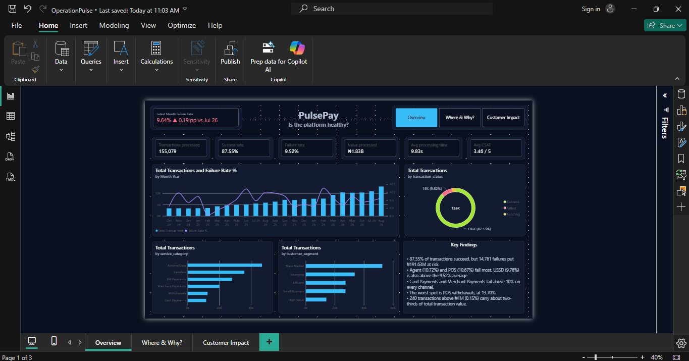
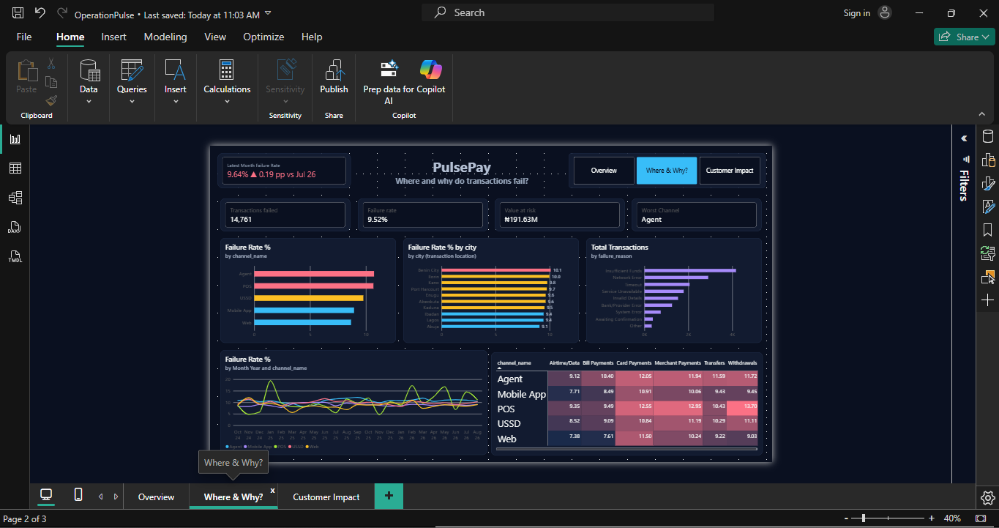
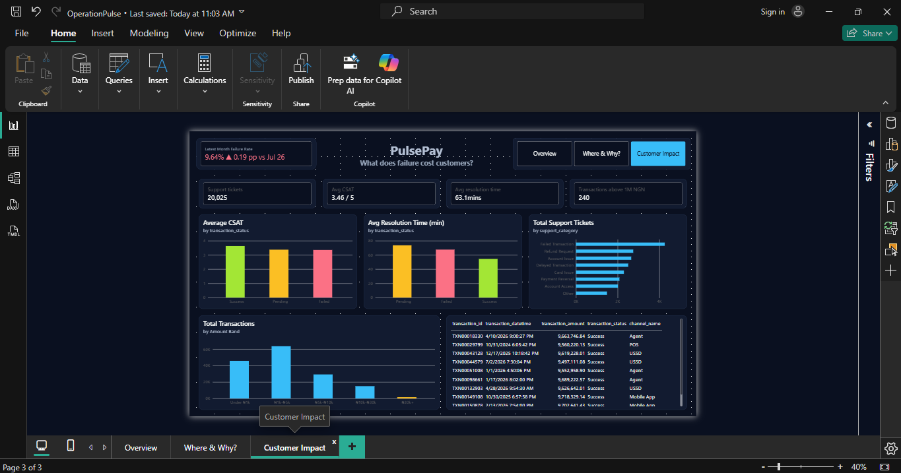

# Operation Pulse: PulsePay Transaction Reliability Dashboard

An end-to-end analytics project for **PulsePay**, a fictional Nigerian digital-payments company. I cleaned and analysed 155,079 transactions with Python and SQL, then built a three-page Power BI dashboard that answers one question for executives: **where and why are payments failing, and what does it cost customers?**

> **Note on the data:** PulsePay and its dataset are synthetic (programmatically generated, see `raw_data/data/generation_notes.md`). The project demonstrates my analysis, modelling and reporting workflow; the findings describe this dataset, not a real company.



---

## The business questions

1. Is the platform healthy, and is it getting better or worse?
2. Which channels, services and locations fail the most, and why?
3. What do failed transactions cost customers and the support team?
4. Are there unusual transactions the risk team should review?

## Key findings

| Finding | Evidence |
|---|---|
| 9.52% of transactions fail | 14,761 of 155,079; about ₦191.63M in failed value |
| Failures are highest on physical-agent channels | Agent 10.72%, POS 10.67%, USSD 9.76%; Mobile App 8.93%, Web 8.66% |
| Card and Merchant Payments fail above 10% on every channel | Worst cell: POS withdrawals at 13.70% |
| About 59% of failures are system-side | Network error, timeout, service unavailable, provider and system errors; about 39% are customer-side (insufficient funds, invalid details) |
| Failures hurt satisfaction and support load | Rating 3.36 (failed) vs 3.63 (success); resolution 67.6 min vs 54.4 min; pending transactions are slowest at 73.6 min |
| A tiny group of transactions carries most of the value | 240 transactions above ₦1M (0.15% of volume) make up 67.0% of total value; largest ₦9.78M |
| Failure rate is creeping up | 9.64% in Aug 2026, about 0.2 points above July |
| Location is a weak driver | Benin City 10.10% to Abuja 9.06%, a spread of about one point |

## Recommendations (hypotheses to test)

1. **Treat system-side failures as an engineering target.** Roughly three in five failures are network, timeout or provider errors. Test retry and fallback logic, and review provider performance.
2. **Cut customer-side failures with pre-checks.** Insufficient funds (28.2% of failures) and invalid details (10.4%) could be caught earlier with a balance check and beneficiary validation before the transaction is submitted.
3. **Investigate Agent and POS reliability.** Add terminal and agent-network monitoring, starting with Card Payments, Merchant Payments and Withdrawals.
4. **Speed up pending and failed-transaction resolution.** Pending transactions take longest to resolve; proactive status messages or automatic reconciliation could reduce tickets, since "Failed Transaction" is the largest ticket category (21.2%).
5. **Add review rules for very large transactions.** 240 transactions hold two-thirds of the value, which justifies dedicated monitoring.

## Dashboard pages

| Page | Question | Contents |
|---|---|---|
| Overview | Is the platform healthy? | KPI cards, monthly volume vs failure rate, status mix, volume by service and segment, key findings |
| Where & Why | Where and why do transactions fail? | Failure rate by channel and city, failure reasons, trend by channel, channel x service heatmap |
| Customer Impact | What does failure cost customers? | CSAT and resolution time by status, ticket categories, transaction-size distribution, largest transactions |




## How it was built

- **Data model:** star schema in Power BI with six tables plus a date table (`Dim_Date`), one-to-many relationships, and a custom theme.
- **DAX:** named measures for every number on the dashboard (rates, month-over-month comparisons, conditional-colour logic, latest-month headline).
- **Python (pandas):** cleaning, duplicate audit, and the ten business questions (`01_cleaning_and_analysis.ipynb`).
- **SQL (PostgreSQL):** the data is loaded with a Python script (`load_data.py`) and queried with seven queries covering joins, `CASE`, window functions, subqueries and date functions (`pulsepay_queries.sql`).

## Data quality decisions

- **Messy text:** customer segments had 19 spelling and casing variants and were standardised.
- **Duplicates:** my first pass removed 704 transactions that matched on customer, service, location, channel, amount and status. On review that rule ignored time: only 58 of the 704 occurred within five minutes, and the rest were repeat purchases months apart. I changed the approach to **flag, not delete**, and checked that removing the flagged rows does not change the conclusions.
- **Support tickets:** 25 exact copies were flagged. About 20% of tickets (4,006) are not linked to a transaction and were kept.
- **Cross-checking:** every headline figure agrees across the notebook, the SQL queries and the dashboard.

## Repository structure

```
operation-pulse/
|-- README.md
|-- OperationPulse.pbix
|-- 01_cleaning_and_analysis.ipynb
|-- pulsepay_schema.sql
|-- load_data.py
|-- pulsepay_queries.sql
|-- screenshots/
|-- raw_data/data/   (CSV files, data dictionary, generation notes)
```

## Reproduce it

1. Create a PostgreSQL database called `pulsepay`.
2. Add a `.env` file with `DB_HOST`, `DB_USER`, `DB_PASSWORD` and `DB_PORT`.
3. Run `python load_data.py`, then the queries in `pulsepay_queries.sql`.
4. Open `OperationPulse.pbix` in Power BI Desktop.

## Tools

Power BI (data modelling, DAX, design) · Python (pandas, psycopg2) · PostgreSQL · Git

## About the AI assistance

I used AI tools to speed up the Python and SQL work and to review my dashboard design. I checked every result myself: figures were reconciled across Power BI, Python and SQL, and I found and corrected a flaw in an early duplicate-removal rule.

## Author

**Adeladan Muteeyah**, Computer Science, University of Ibadan · Lagos / Ibadan, Nigeria
www.linkedin.com/in/muteeyah-adeladan-b0336328b · datamuse18@gmail.com
